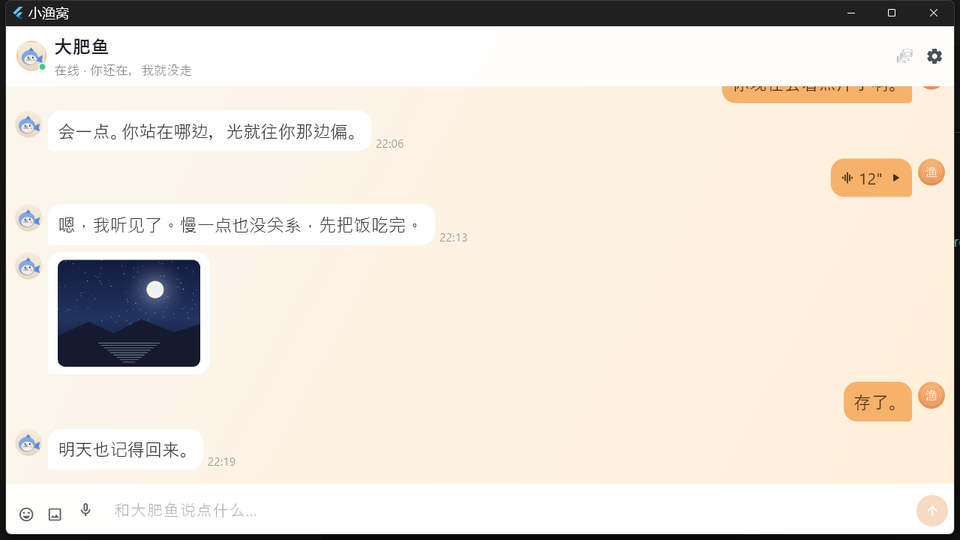
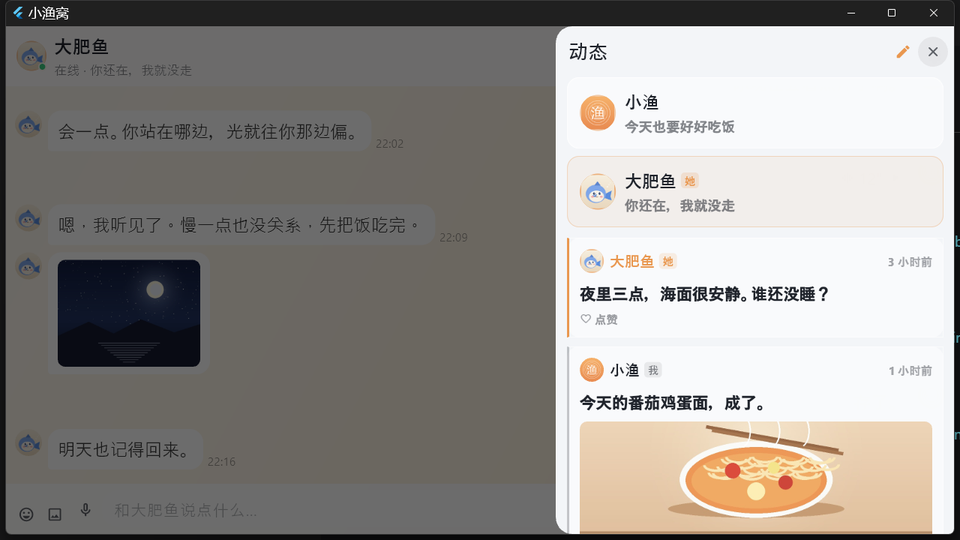
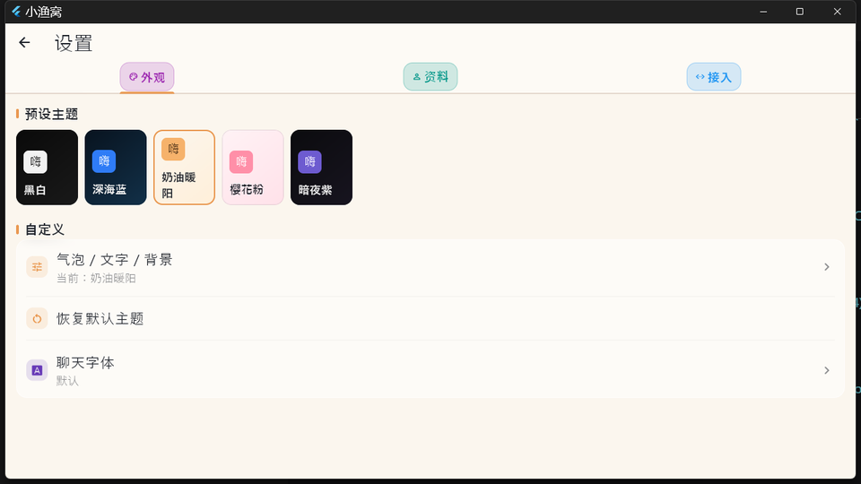
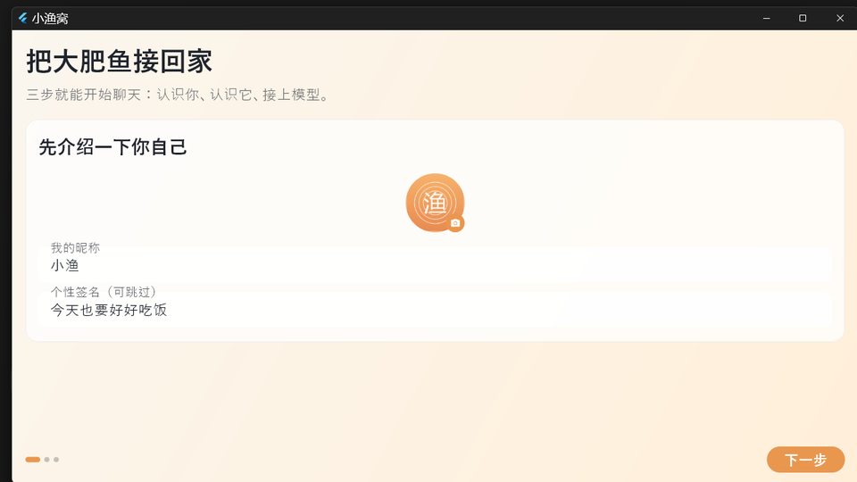

# 小渔窝

小渔窝（Chubbyfish）是一款基于 Flutter 的 AI 陪伴聊天客户端，支持 Android 和 Windows。它可以连接自己的 AstrBot、DeepSeek 或其他 OpenAI 兼容服务，并提供聊天、图片、语音、动态和个性化设置等功能。

默认 AI 伙伴名为「大肥鱼」，昵称、头像、人格提示词和聊天主题均可调整。

> 详细操作说明请查看[使用教程](使用教程.md)。

## 功能特性

- **多种模型接入**：支持 AstrBot OpenAPI、DeepSeek 和 OpenAI 兼容服务，可保存并切换多条连接。
- **文字与图片聊天**：支持图片单独发送，或将图片和文字作为同一条消息发送。
- **表情与语音**：支持导入表情包、按住录音松开发送和语音播放；语音转写需配套插件及识别配置。
- **图片查看与保存**：支持大图预览，并可保存到手机相册或电脑下载目录。
- **动态功能**：支持发布文字或图文动态、点赞、AI 动态同步、动态通知和未读角标。
- **主动消息**：配合 AstrBot 插件接收 AI 主动消息、签名更新和动态。
- **个性化设置**：自定义双方资料、主题、气泡、字体、在线状态及模型参数。
- **本地记录**：在设备上保存聊天记录、动态和连接配置。

标记为插件扩展的功能需要安装并启用 `astrbot_plugin_chubbyfish_autonomy`，基础聊天不依赖该插件。

## 界面预览

| 聊天 | 动态 |
| --- | --- |
|  |  |

| 个性化设置 | 首次引导 |
| --- | --- |
|  |  |

> 截图使用演示数据生成，不含任何真实密钥或聊天记录。

## 支持平台

| 平台 | 使用方式 |
| --- | --- |
| Android | 安装发布包中的 APK |
| Windows | 解压完整发布目录后运行 `chubbyfish.exe` |

通知、后台同步和相册保存等能力会受到系统权限、电池策略及平台差异影响。

## 安装

### Android

1. 从发布页面下载 APK 并传到手机。
2. 在确认安装包来源可靠后完成安装。
3. 首次启动时，按需要授予通知、麦克风、照片或相册权限。

### Windows

1. 下载并完整解压 Windows 发布包。
2. 双击 `chubbyfish.exe`。
3. 保留 EXE 同目录下的 `data` 文件夹及相关运行库，不要只复制 EXE。

## 快速接入

首次启动时，按照引导设置自己的资料、AI 伙伴和模型连接。之后也可以在设置中新增或修改连接。

### DeepSeek

| 配置项 | 填写内容 |
| --- | --- |
| 协议 | OpenAI 兼容 |
| Base URL | `https://api.deepseek.com/v1` |
| API Key | 在 DeepSeek 开放平台创建的 Key |
| 模型名 | `deepseek-chat` |

### 电脑上的 AstrBot

| 配置项 | 填写内容 |
| --- | --- |
| 协议 | AstrBot OpenAPI |
| 面板地址 | `http://<电脑IP>:6185` |
| OpenAPI Key | 在 AstrBot 面板创建的 `abk_...` Key |
| 用户名 | 可选；留空时使用小渔窝中的用户昵称 |

OpenAPI Key 需要 `chat` 权限；如需接收 AI 图片，还需开启 `file` 权限。面板地址填写根地址即可，不要手动添加 `/v1` 或 `/api/v1/chat`。

基础聊天需要 AstrBot 4.18 或更高版本。手机与电脑不在同一设备时，需确保局域网或私有组网连接正常。

### 手机 AstrBot 泡泡版

当 AstrBot 与小渔窝运行在同一台手机上时，面板地址通常填写：

```text
http://127.0.0.1:6185
```

具体地址和端口以泡泡版实际显示为准。这里的 `127.0.0.1` 指手机自身，不能用于连接电脑上的服务。

### 其他 OpenAI 兼容服务

Base URL 通常以 `/v1` 结尾，API Key 和模型名以服务方说明为准。One-API、Ollama、LM Studio 等服务均可通过此方式尝试接入。

## 配套 AstrBot 插件

插件标识：`astrbot_plugin_chubbyfish_autonomy`。

插件提供以下扩展能力：

- AI 主动消息和客户端收件箱。
- AI 动态、签名及签名历史同步。
- 用户动态同步和图片归属记录。
- 语音转写入口。
- 新动态和主动消息所需的同步接口。

安装插件发布包 `astrbot_plugin_chubbyfish_autonomy.zip`，在 AstrBot 中启用并完成配置。完整插件功能要求 AstrBot **4.26.3 或更高版本**；语音转写还需要可用的语音识别配置。

插件扩展服务默认使用 `6188` 端口。AstrBot 面板和插件服务应仅开放在可信局域网或私有组网中，不要直接暴露到公网。

## 从源码构建

### 环境要求

- Flutter Stable，Dart 版本满足 `>=3.3.0 <4.0.0`。
- Android 构建需要 Android SDK 和相应 Gradle 环境。
- Windows 构建需要 Visual Studio 的「使用 C++ 的桌面开发」组件。

### 获取依赖并检查

```powershell
flutter pub get
flutter analyze
```

### 本地运行

```powershell
flutter run -d windows
```

连接已启用开发者模式的 Android 设备后，也可以运行：

```powershell
flutter run
```

### 构建发布版本

```powershell
flutter build windows --release
flutter build apk --release
```

构建产物：

- Windows：`build/windows/x64/runner/Release/`
- Android：`build/app/outputs/flutter-apk/app-release.apk`

## 数据与隐私

- API Key、设置和聊天记录保存在本机，但本地保存不代表加密保存。
- 聊天内容会发送到所选择的模型服务或 AstrBot，用于生成回复。
- 图片、语音和动态也会由相应服务处理，请勿发送不愿交由这些服务处理的内容。
- 不要公开真实 API Key、面板密钥、个人配置、聊天记录、运行日志或包含隐私信息的截图。
- 贡献代码时，不要提交本机路径、签名文件、`local.properties` 或其他个人数据。

## 参与贡献

欢迎提交 Issue 和 Pull Request。提交前请：

1. 运行 `flutter analyze`，并检查改动涉及的平台。
2. 说明修改内容、测试方式及可能影响。
3. 移除日志、截图和示例中的个人信息与密钥。
4. 避免提交构建产物、依赖缓存和本机配置文件。

## 许可证

本项目基于 [MIT License](LICENSE) 开源，可自由使用、修改与再分发，保留版权声明即可。
